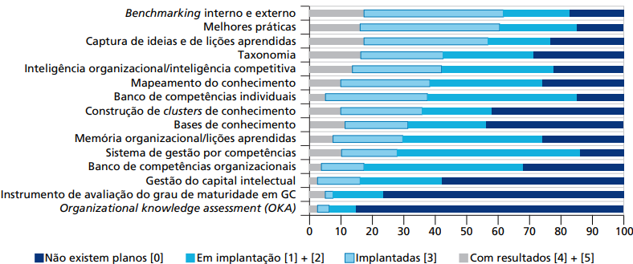
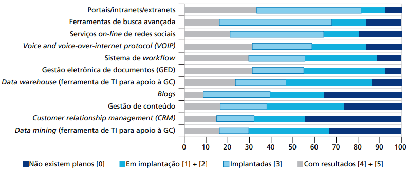

# SUMÁRIO

# 1 CONTEXTUALIZAÇÃO

A gestão do conhecimento, que inclui captar, difundir e compartilhar informações, é essencial para que uma organização, seja ela privada ou pública, ganhe eficiência, promova inovação, aprimore a tomada de decisão e alcance seus objetivos, de forma dinâmica e em adaptação constante. Para isso, torna-se necessário desenvolver uma cultura de comunicação aberta e fluida, bem como incentivar a interação entre colaboradores, sistemas e recursos organizacionais, com confiança, empatia e alinhamento de objetivos, de modo a criar ambientes que favoreçam a experimentação e o diálogo (SILVA; SOUZA, 2025, p. 64-68).

Entretanto, entre os principais desafios do setor público está a perda de conhecimento tácito, agravada pela alta rotatividade de servidores, pelas aposentadorias, pelas mudanças de gestão e pelas barreiras burocráticas, bem como pela ausência de uma cultura voltada à aprendizagem organizacional continuada e à inovação (SILVA; SOUZA, 2025, p. 70). A limitação de conhecimento sobre processos de gestão da informação, a falta de recursos humanos e orçamentários e o uso de linguagem própria e técnica de cada setor também podem ser elencados como desafios para a implementação de sistemas de gerenciamento do conhecimento (SCLESINGER *et al.*, 2008 apud RIPOLI; MARTELLO; BUSSADORI, 2022, p. 2).

Esse cenário impacta negativamente a prestação dos serviços públicos e o atendimento das demandas da população por qualidade, diversidade, continuidade, transparência e inovação (SILVA; SOUZA, 2025, p. 71). Pode-se ainda dizer que a ausência de gestão do conhecimento gera ineficiência nos gastos públicos e na administração, além de contribuir para o fracasso na implantação de programas (RIPOLI; MARTELLO; BUSSADORI, 2022, p. 13).

Portanto, para enfrentar esse cenário, torna-se essencial a utilização de ferramentas, sistemas e métodos de gestão do conhecimento, como os sistemas de gestão de conteúdo (*Content Management System* – CMS), as plataformas colaborativas (redes corporativas e *wikis*), as bases de dados e repositórios de conhecimento e as ferramentas de aprendizado *online* (SILVA; SOUZA, 2025, p. 67-69). Segundo FIA (2009 apud RIBEIRO; IZQUIERDO, 2017, p. 67-73), pode-se elencar ainda técnicas como: redes de pessoas, páginas amarelas, comunidades de práticas, divulgação de práticas relevantes, registro de lições aprendidas, *brainstorming*, *storytelling*, entrevistas de saída, mapas de conhecimento, *coaching* e repositórios de conhecimento.

Nesse contexto, destaca-se a abordagem *Docs as Code*, que se apresenta como uma alternativa para a gestão da documentação institucional. Segundo Gentle (2023), tratar a documentação como código significa armazenar os arquivos em um sistema de controle de versões, gerar documentos automaticamente, submetê-los à revisão de pessoas de confiança e publicá-los com pouca intervenção manual. Além disso, a abordagem favorece o trabalho remoto e a comunicação assíncrona, uma vez que as notificações e as ferramentas das plataformas de versionamento facilitam a distribuição do trabalho de forma colaborativa (GENTLE, 2023). Como cada tarefa distribuída fica registrada na plataforma, com seu responsável, sua discussão e as alterações realizadas, esse histórico permanece disponível mesmo após a saída do autor, o que pode contribuir para reduzir a perda de memória institucional.

# 2 OBJETIVO

## 2.1 Tema e delimitação

O tema desta pesquisa é a gestão do conhecimento e a preservação da memória institucional na Administração Pública por meio da abordagem *Docs as Code*.

## 2.2 Objetivo Geral

A partir do contexto e da delimitação do tema apresentados, o objetivo geral da pesquisa será: investigar a aplicabilidade dos princípios do *Docs as Code* como estratégia de mitigação da perda de memória institucional e aprimoramento do ciclo de vida do conhecimento explícito na Administração Pública.

## 2.3 Objetivos Específicos

Para alcançar o objetivo geral, a pesquisa terá como objetivos específicos:

1) identificar, por meio da literatura, os fatores organizacionais e operacionais que causam a fragmentação da documentação e o esvaziamento da memória institucional na rotina do setor público;

2) correlacionar as práticas de *Docs as Code* com as etapas de criação, retenção e disseminação da Gestão do Conhecimento;

3) analisar os requisitos técnicos, normativos e as barreiras culturais para a implementação dessa abordagem em equipes multidisciplinares da Administração Pública;

4) propor diretrizes práticas de fluxo de trabalho baseado em *Docs as Code*, voltado à sustentabilidade e atualização contínua da documentação institucional.

# 3 JUSTIFICATIVA

No setor público, um dos problemas enfrentados é a descontinuidade dos processos administrativos e o risco de perda de capital intelectual, decorrentes da rotatividade e da aposentadoria de servidores que detêm o conhecimento técnico, sem que esse saber seja repassado aos demais. Para reverter esse cenário e garantir a manutenção do conhecimento apesar das mudanças, é importante instituir a aprendizagem organizacional, que cria uma memória institucional por meio de ferramentas e técnicas de gestão do conhecimento (RODRIGUES, 2026). Porém, para que essa memória se forme, deve-se registrar o conhecimento, o que nem sempre ocorre na prática.

Essa dificuldade pode ser observada por meio da pesquisa do Ipea realizada em 2014 com 81 organizações da administração pública federal. Nas práticas relacionadas a processos facilitadores da gestão do conhecimento (Gráfico 1), não havia planos de implantação em 35% dos casos, 31% estavam em implantação ou planejamento, 24% estavam implantadas sem resultados relatados e apenas 10% estavam implantadas e produzindo resultados. Já nas práticas relacionadas à base tecnológica e funcional de suporte à gestão do conhecimento (Gráfico 2), nota-se que as ferramentas de tecnologia da informação (TI) são mais utilizadas, com 52% dos casos implantados, sendo 22% com resultados (BATISTA; QUANDT, 2015).

Gráfico 1 – Estágio de implantação das práticas de gestão do conhecimento relacionadas a processos nas 81 organizações pesquisadas em 2014 (%)

Fonte: Batista e Quandt (2015, p. 102).

Gráfico 2 – Estágio de implantação das práticas de gestão do conhecimento relacionadas à tecnologia nas 81 organizações pesquisadas em 2014 (%)

Fonte: Batista e Quandt (2015, p. 104).

O resultado indica que apenas a disponibilização de ferramentas tecnológicas não garante uma gestão eficiente do conhecimento. O desafio está em integrar a tecnologia aos processos de trabalho, de modo que documentar se torne uma prática contínua e cultural. Nesse ponto, o *Docs as Code* pode contribuir, tratando a documentação com as mesmas práticas do desenvolvimento de software: o sistema de controle de versões funciona como um sistema de gestão de conteúdo (CMS), concentrando a documentação em um único repositório, com controle de acesso, revisão, fluxo de aprovação e publicação (GENTLE, 2023, p. 36).

Apesar desse potencial, o tema ainda é pouco explorado. Um levantamento da literatura no Google Acadêmico, nos periódicos da CAPES e no repositório da ENAP, com palavras-chave como "*docs as code*", "*public administration*" e "*knowledge*", retornou apenas três artigos internacionais, conforme apresentado na Tabela 1. A mesma busca, com termos em português, não encontrou nenhum trabalho. Desses registros, apenas dois puderam ser consultados gratuitamente: um aborda *Docs as Code* apenas na arquitetura corporativa de TI em empresas (MAMEDGULIEV; TCUKANOVA, 2026), e o outro trata de uma plataforma pública de participação democrática, sem discutir a documentação como código (BARANDIARAN *et al.*, 2024).

&nbsp;

&nbsp;

Tabela 1 – Resultados da busca bibliográfica

| Termos de busca | Google Acadêmico | Periódicos CAPES | ENAP |
| --- | :---: | :---: | :---: |
| "*Docs as code*" AND "Administração Pública" AND "Conhecimento" | 0 | 0 | 0 |
| "Documentos como código" AND "Administração Pública" AND "Gestão do conhecimento" | 0 | 0 | 0 |
| "*Docs as code*" AND "*public administration*" AND "*knowledge*" | 3\* | 0 | 0 |

Fonte: Elaboração própria, com base em busca realizada em 04 nov. 2026.\
\* Um dos registros não estava disponível para acesso.

Essa lacuna justifica a pesquisa, que pretende contribuir para os estudos de gestão do conhecimento nos órgãos públicos, ao relacioná-los aos princípios e técnicas do *Docs as Code*, e para a prática dessas organizações, ao propor diretrizes que apoiem a preservação de sua memória institucional.

# 4 OBJETO

## 4.1 Problema

[De que maneira a adoção dos princípios e práticas de *Docs as Code* pode mitigar a perda de memória institucional e aprimorar a gestão do ciclo de vida do conhecimento explícito na Administração Pública?] - [Gentle (2023) e Mamedguliev e Tcukanova (2026)]

## 4.2 Hipóteses

Parte-se das seguintes hipóteses:

1) o controle de versões por meio de *commits*, *tags* e *releases*, além da criação de *branches* e *pull requests*, permite ao usuário manter um histórico organizado e recuperável da documentação (GENTLE, 2023, p. 168-170);

2) a visualização das alterações entre versões facilita a revisão dos documentos (GENTLE, 2023, p. 31) e a identificação de quem os alterou e do que foi modificado;

3) a definição de quem pode alterar os documentos, aliada à solicitação de revisão por outra pessoa, que pode comentar cada linha alterada, aumenta a confiabilidade da documentação institucional e a proteção do acesso a ela (GENTLE, 2023, p. 144-146);

4) a automação da publicação e de testes, como a verificação de *links*, ortografia, estilo e linguagem inclusiva, permite que a documentação seja produzida com controle de qualidade e fique atualizada prontamente (GENTLE, 2023, p. 120-127);

5) a distribuição das atividades, registradas em *issues* e acompanhadas em painéis, torna o trabalho mais transparente e preserva o histórico das discussões e decisões (GENTLE, 2023, p. 134-135);

6) a comunicação assíncrona, por ocorrer de forma registrada nas próprias plataformas (GENTLE, 2023, p. 24-25), contribui para reduzir a perda de conhecimento decorrente da rotatividade de servidores;

7) a adoção da abordagem pode enfrentar dificuldades, como a resistência cultural, a curva de aprendizado das ferramentas de versionamento e a inadequação a alguns contextos, como o tratamento de dados sensíveis.

# 5 METODOLOGIA

A pesquisa a ser desenvolvida se classifica como: básica, quanto à natureza; qualitativa, quanto à abordagem; e exploratória, quanto ao objetivo. No que se refere aos procedimentos, trata-se de uma pesquisa de abordagem teórica, que utilizará pesquisa bibliográfica e documental.

Segundo Gerhardt e Silveira (2009, p. 34), o objetivo da pesquisa básica é "gerar conhecimentos novos, úteis para o avanço da Ciência, sem aplicação prática prevista". Dessa forma, a pesquisa buscará tratar da aplicação dos princípios *Docs as Code* na gestão do conhecimento da Administração Pública, propondo diretrizes de fluxo de trabalho, mas sem a pretensão de implementá-las em um órgão específico.

Pode ser classificada também como uma pesquisa qualitativa, que "não se preocupa com representatividade numérica,
mas, sim, com o aprofundamento da compreensão de um grupo social, de uma organização, etc." (GERHARDT; SILVEIRA, 2009, p. 31-32). O que se enquadra na pesquisa, por ela não fazer uso de dados quantitativos para abordar o tema, dependendo da descrição e interpretação da literatura analisada.

Quanto aos objetivos, trata-se de uma pesquisa exploratória, que busca "proporcionar maior familiaridade com o
problema, com vistas a torná-lo mais explícito ou a constituir hipóteses" (GIL, 2002, p. 41), o que se justifica pela ausência de estudos que relacionem *Docs as Code* à Administração Pública.

Inicialmente, para construir o referencial teórico da pesquisa, será realizada uma pesquisa bibliográfica, ou de fontes secundárias, que já foram publicadas. Para isso, serão buscados livros, artigos, documentações técnicas e sites sobre gestão do conhecimento, memória institucional e *Docs as Code*. Aliado a isso, pretende-se realizar uma pesquisa documental, ou seja, a coleta de dados a partir de uma fonte primária de documentos, escritos ou não. Nesse caso, serão documentos institucionais e técnicos produzidos por órgãos públicos que tratam da produção, do versionamento e da disseminação de sua documentação (MARCONI; LAKATOS, 2010, p. 157-168).

O objetivo, ao final da coleta e sistematização dos dados, é analisar qualitativamente as informações levantadas, relacionando as práticas de *Docs as Code* às etapas de gestão do conhecimento. A partir dessa análise, pretende-se identificar benefícios, dificuldades e desvantagens da adoção dessa abordagem e propor diretrizes de fluxo de trabalho voltadas à atualização contínua da documentação institucional.

# 6 EMBASAMENTO TEÓRICO

[Esse é o esqueleto do trabalho final. Aqui no projeto é bem sucinto.]

### GESTÃO DO CONHECIMENTO E ADMINISTRAÇÃO PÚBLICA

- CONCEITOS - Citar Davenport e Prusak e Nonaka e Takeuchi
- PRINCÍPIOS
- GC NA ADMINISTRAÇÃO PÚBLICA - Ripoli, Martello e Bussadori (2022), Silva e Souza (2025) e Rodrigues (2026)

### DOCS AS CODE

- CONCEITOS - Gentle (2023)
- PRINCÍPIOS

### DOCS AS CODE E ADMINISTRAÇÃO PÚBLICA (O PRINCIPAL DO SEU TRABALHO)

# 7 CRONOGRAMA

O Quadro 1 apresenta o cronograma de execução da pesquisa.

Quadro 1 – Cronograma da pesquisa

| Atividades | nov/26 | dez/26 | jan/27 | fev/27 | mar/27 | abr/27 |
| --- | :---: | :---: | :---: | :---: | :---: | :---: |
| 1 Elaboração do projeto | X | | | | | |
| 2 Levantamento bibliográfico e documental | X | X | X | | | |
| 3 Leitura e fichamento da bibliografia | | X | X | X | | |
| 4 Redação do referencial teórico | | | X | X | | |
| 5 Análise qualitativa da literatura e dos documentos | | | | X | X | |
| 6 Elaboração das diretrizes de fluxo de trabalho em *Docs as Code* | | | | | X | |
| 7 Redação da introdução e da conclusão | | | | | X | |
| 8 Revisão e normalização do trabalho | | | | | X | X |
| 9 Apresentação da monografia | | | | | | X |

Fonte: Elaboração própria (2026).

# REFERÊNCIAS

BARANDIARAN, Xabier E. *et al.* **Decidim, a technopolitical network for participatory democracy**: philosophy, practice and autonomy of a collective platform in the age of digital intelligence. Cham: Springer, 2024. (SpringerBriefs in Political Science).

BATISTA, Fábio Ferreira; QUANDT, Carlos Olavo. **Gestão do conhecimento na administração pública**: resultados da Pesquisa Ipea 2014 – práticas de gestão do conhecimento. Brasília: Ipea, 2015. (Texto para Discussão, n. 2120).

GENTLE, Anne. **Docs like code**: collaborate and automate to improve technical documentation. 3. ed. Austin: Just Write Click, 2023. E-book.

GERHARDT, Tatiana Engel; SILVEIRA, Denise Tolfo. **Métodos de pesquisa**. Porto Alegre: Editora da UFRGS, 2009. Disponível em: https://lume.ufrgs.br/handle/10183/52806. Acesso em: 06 nov. 2026.

GIL, Antônio Carlos. **Como elaborar projetos de pesquisa**. 4. ed. São Paulo: Atlas, 2002.

MAMEDGULIEV, Ruslan Islamovich; TCUKANOVA, Olga Anatolievna. Research and analysis of approaches and views of IT specialists on the system, corporate and business architecture of the enterprise: trends, challenges, development prospects. **Business Informatics**, Moscou, v. 20, n. 3, p. 69-89, 2026. DOI: 10.17323/2587-814X.2026.3.69.89.

MARCONI, Marina de Andrade; LAKATOS, Eva Maria. **Fundamentos de metodologia científica**. 7. ed. São Paulo: Atlas, 2010.

RIBEIRO, Elizabeth Matos; IZQUIERDO, Oscar Chassagnes. **Gestão do conhecimento e governança no setor público**. Salvador: UFBA, 2017. E-book (104 p.). (Coleção Gestão de pessoas com ênfase em gestão de competências). ISBN 978-85-8292-067-1.

RIPOLI, Simone Cristina Ceron; MARTELLO, Marcelo Ricardo; BUSSADORI, Meiriellen Cristina Faria. Aspectos relevantes para o desenvolvimento de um programa de gestão do conhecimento para a administração pública. **AtoZ**: novas práticas em informação e conhecimento, Curitiba, v. 11, p. 1-15, 2022. DOI: https://doi.org/10.5380/atoz.v11.83420.

RODRIGUES, Alexandra Soares. Gestão do conhecimento no setor público: a integração estratégica do e-learning como instrumento de inovação administrativa. **Revista Tópicos**, [s. l.], 17 jun. 2026. DOI: https://doi.org/10.70773/revistatopicos/781579878.

SILVA, Edson Souza; SOUZA, Talita da Silva Livramento. Desafios e perspectivas da gestão do conhecimento na administração pública. **Destaques Acadêmicos**, Lajeado, v. 17, n. 1, p. 63-73, 2025. DOI: https://dx.doi.org/10.22410/issn.2176-3070.v17i1a2025.4061.
